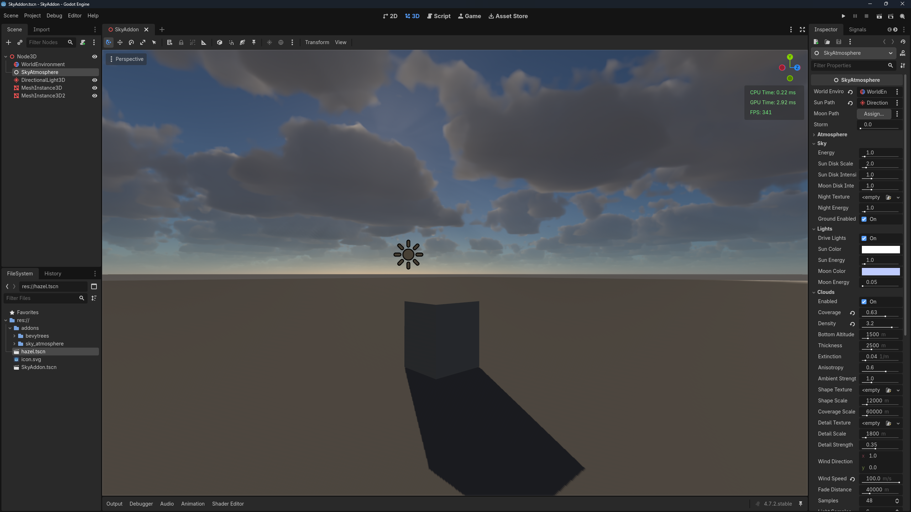
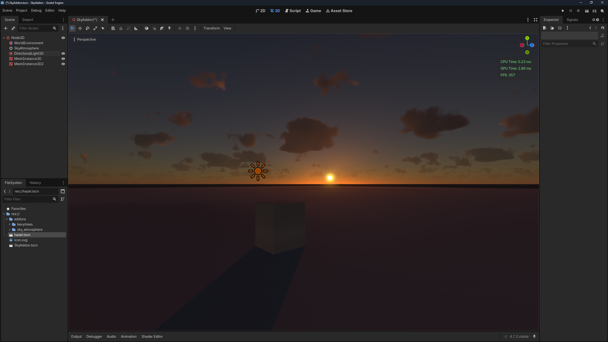

# Bruneton Sky Atmosphere for Godot

A native GDExtension for Godot with Bruneton atmospheric scattering, volumetric clouds, and configurable weather.

## Screenshots

### Daytime clouds



### Sunset



## Features

- Bruneton atmospheric scattering with precomputed transmittance, scattering, and irradiance textures.
- Configurable Rayleigh and Mie scattering, ozone absorption, planet radius, atmosphere height, and ground albedo.
- Sun and moon disks, directional light controls, and an optional night sky texture.
- Volumetric clouds with coverage, density, altitude, thickness, wind, and sampling controls.
- Storm settings, lightning, fog, cloud shadows, aerial perspective, and god rays.
- Example `SkyCycleProfile` resources for a day cycle, clear weather, overcast weather, and storms.

## Requirements

- **Godot 4.7 or later.** The included `.gdextension` declares `compatibility_minimum = "4.7"`. This package was checked with Godot 4.7.2; compatibility with earlier Godot 4.x versions is not provided by this build.
- **Windows x86_64** for the included debug and release DLLs.
- Use a renderer with RenderingDevice support, such as **Forward+**, for the atmosphere's compute features.

The extension configuration also lists Linux and macOS library paths, but those binaries are not included in this package. Native C++ sources and a build system are not included here.

## Installation

1. Download this repository as a ZIP or clone it.
2. Copy `addons/sky_atmosphere` into your Godot project's `addons` directory:

   ```text
   your_project/
   ├── project.godot
   └── addons/
       └── sky_atmosphere/
           ├── sky_atmosphere.gdextension
           ├── bin/
           ├── profiles/
           ├── shaders/
           └── tools/
   ```

3. Open or restart the project in Godot so the native extension is loaded.
4. Add a `SkyAtmosphere` node to your 3D scene.
5. Add a `WorldEnvironment` and a `DirectionalLight3D` for the sun. Assign them to the node's **World Environment Path** and **Sun Path** properties. An additional directional light can be assigned to **Moon Path**.
6. Adjust the atmosphere, clouds, lights, fog, and storm settings in the Inspector. Rotate the sun light to change the sun's position.

This is a native GDExtension and does not require enabling an editor plugin.

## Basic configuration

For a scene with `SkyAtmosphere`, `WorldEnvironment`, and `Sun` as sibling nodes:

```gdscript
extends Node3D

@onready var atmosphere: SkyAtmosphere = $SkyAtmosphere

func _ready() -> void:
    atmosphere.world_environment_path = NodePath("../WorldEnvironment")
    atmosphere.sun_path = NodePath("../Sun")
    atmosphere.clouds_enabled = true
    atmosphere.clouds_coverage = 0.63
    atmosphere.clouds_density = 3.2
    atmosphere.storm = 0.0
```

The shader parameters are managed by `SkyAtmosphere`; configure the node's properties in the Inspector or from scripts.

## Included profiles

| Resource | Purpose |
| --- | --- |
| `profiles/day.tres` | Example cloud and fog curves over a day |
| `profiles/weather_clear.tres` | Clear weather settings |
| `profiles/weather_overcast.tres` | Overcast weather settings |
| `profiles/weather_storm.tres` | Storm weather settings |

`tools/make_profiles.gd` regenerates these example resources. Run it from a Godot project containing the installed extension:

```sh
godot --headless --path /path/to/your_project --script res://addons/sky_atmosphere/tools/make_profiles.gd
```

## License

[MIT](LICENSE).

The atmospheric scattering model is based on Eric Bruneton's precomputed atmosphere work, as described in the shader source comments.
